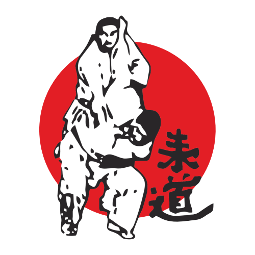
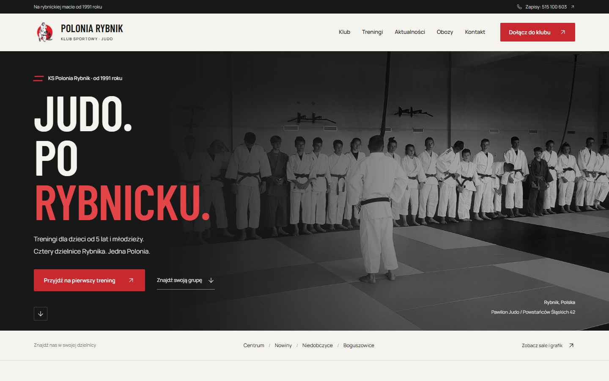
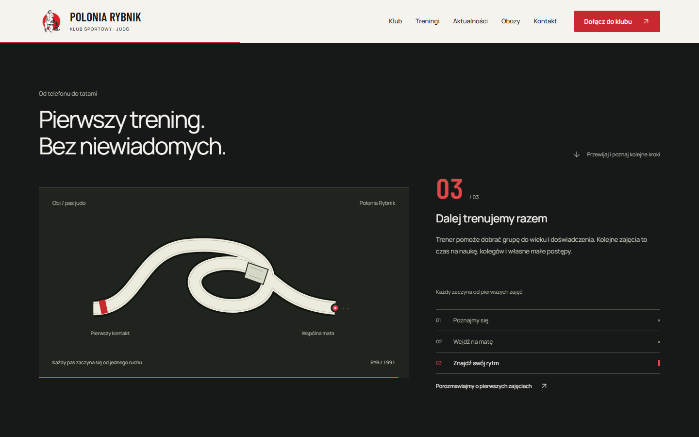
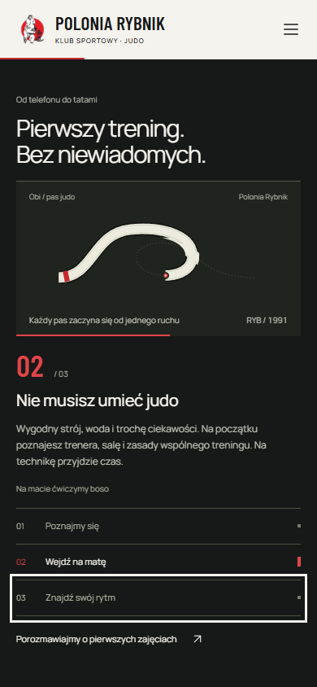
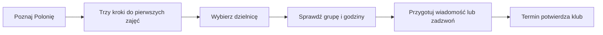
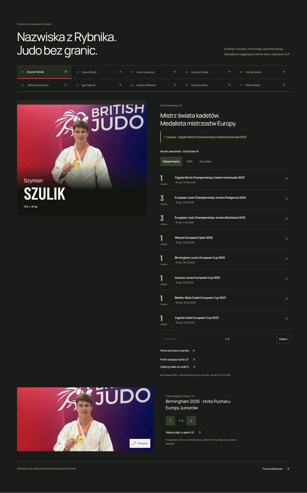
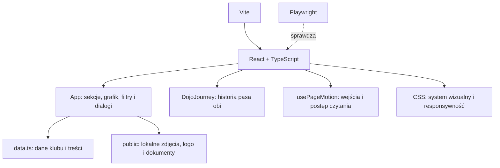
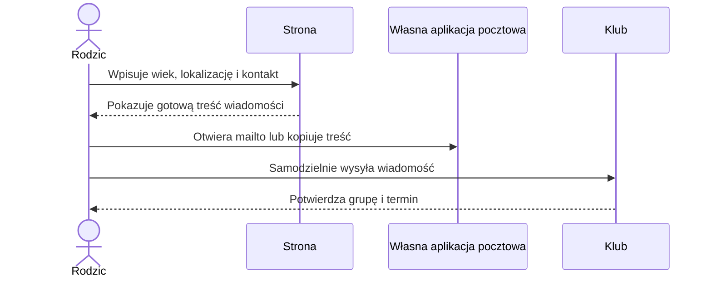

<div align="center">



# JUDO. PO RYBNICKU.

**KS Polonia Rybnik — sportowa strona z własnym rytmem.**

Autentyczni ludzie. Prawdziwe dojo. Interakcje, które pomagają wejść na matę.

`React 19` · `TypeScript` · `Vite 6` · `Tailwind CSS 4` · `Lucide` · `Playwright`

[Zobacz projekt](#projekt) · [Funkcje](#funkcje) · [Uruchom](#uruchomienie) · [Architektura](#architektura) · [Testy](#testy)

</div>



<a id="projekt"></a>

## Klub, który ma własną twarz

Strona prowadzi rodzica od poznania klubu do wyboru sali, grupy i kontaktu w sprawie pierwszego treningu. Zawodnik znajdzie grafik, wiadomości, fotografie oraz dokumenty. Całość jest po polsku i zachowuje oryginalne logo KS Polonia Rybnik.

Zamiast anonimowego zestawu kart: plakatowy początek, redakcyjna kompozycja, reportażowe fotografie i własna ilustracja pasa judo. Czerwień wynika ze znaku klubu, a nie z przypadkowego motywu kolorystycznego.

> **Jedna wyróżniająca interakcja:** przewijanie rozwija pas obi i prowadzi przez trzy kroki przed pierwszym treningiem. Na niskim ekranie lub przy ograniczeniu ruchu te same informacje wybiera się przyciskami.

### Zobacz ruch

[▶ Nagranie działającej strony — 21 sekund, MP4](design-references/motion-review/polonia-animations.mp4)

<table>
  <tr>
    <td width="74%"></td>
    <td width="26%"></td>
  </tr>
  <tr>
    <td align="center"><b>Komputer — przypięta narracja, naturalne przewijanie</b></td>
    <td align="center"><b>Telefon — treść w zasięgu kciuka</b></td>
  </tr>
</table>

<a id="funkcje"></a>

## Od pierwszego spojrzenia do pierwszego treningu



| Miejsce | Co można zrobić |
| :--- | :--- |
| **Klub** | Poznać lokalny charakter Polonii i zobaczyć jej prawdziwe fotografie |
| **Pierwszy trening** | Przejść przez trzy kroki: kontakt, wejście na matę, dobór grupy |
| **Treningi** | Przełączać Centrum, Nowiny, Niedobczyce i Boguszowice; filtrować konkretne grupy i otworzyć dojazd |
| **Klubowy dziennik** | Filtrować wiadomości, otworzyć artykuł i przejść do oficjalnego źródła |
| **Półkolonie** | Sprawdzić turnusy zimowe 2027, informacje organizacyjne i pobrać kartę kwalifikacyjną |
| **Ludzie i galeria** | Oglądać portrety, powiększać zdjęcia i przechodzić między nimi klawiaturą |
| **Nazwiska z Rybnika** | Poznać 10 zawodników, przejrzeć najważniejsze osiągnięcia, sezon 2026 i wszystkie starty IJF bezpośrednio w profilu |
| **Archiwum IJF** | Filtrować 219 wpisów: 182 starty turniejowe i 37 wydarzeń treningowych; pobrać CSV i udostępnić profil |
| **FAQ i dokumenty** | Sprawdzić odpowiedzi przed pierwszym treningiem i pobrać deklarację członkowską |
| **Kontakt** | Zadzwonić lub przygotować wiadomość e-mail z danymi potrzebnymi do dobrania zajęć |

### Ruch z konkretnym zadaniem

Profile i archiwum korzystają z jednego zbioru danych IJF, zweryfikowanego 16.11.2026. Brak opublikowanej lokaty oznacza udział, nie przegraną. Zakres, źródła i ograniczenia: [dane IJF](docs/ijf-results-sources.md), [fotografie](docs/athlete-photo-refresh.md), [weryfikacja profili](docs/profile-refresh.md).



| Efekt | Implementacja | Po co |
| :--- | :--- | :--- |
| Odsłonięcie liter hero | CSS, pojedyncza sekwencja | Nadaje wejściu sportowy rytm |
| Pas obi | SVG + `requestAnimationFrame` | Łączy przewijanie z trzema krokami przed zajęciami |
| Odsłonięcie fotografii | Intersection Observer + Web Animations API | Buduje jeden wyraźny moment fotograficzny |
| Zmiana grafiku i filtrów | Krótkie przejścia stanów | Pokazuje, że treść została zmieniona |
| Linia w nagłówku | Postęp przewijania | Ułatwia orientację w długiej stronie |

Bez biblioteki animacyjnej, przechwytywania kółka myszy i zapętlonych dekoracji. Obsługiwane jest `prefers-reduced-motion`.

<a id="uruchomienie"></a>

## Uruchomienie w minutę

Potrzebujesz **Node.js 22** i **npm**.

```bash
git clone https://github.com/wojtekp2002/judo_club_one-page.git
cd judo_club_one-page
npm ci
npm run dev
```

Otwórz adres wypisany przez Vite, domyślnie **http://127.0.0.1:5173**.

| Polecenie | Działanie |
| :--- | :--- |
| `npm run dev` | Lokalny serwer z odświeżaniem po zmianach |
| `npm run build` | Kontrola TypeScript i gotowa wersja w `dist/` |
| `npm run preview` | Podgląd zbudowanej wersji |
| `npm run test:e2e` | Testy funkcji i responsywności w Chrome |
| `npm run test:motion` | Testy historii obi, klawiatury i ograniczonego ruchu |

<a id="architektura"></a>

## Mało warstw. Jasne odpowiedzialności.



```text
src/
├── App.tsx              # strona i działające interakcje
├── DojoJourney.tsx      # trzy etapy opowieści i ilustracja SVG
├── usePageMotion.ts     # jednorazowe wejścia i postęp przewijania
├── data.ts              # informacje, grafik, artykuły i fotografie
├── styles.css           # bazowy system i układy
└── experience.css       # kompozycja redakcyjna i ruch
public/
├── images/              # fotografie klubu, logo, partnerzy
└── documents/           # oryginalne dokumenty do pobrania
scripts/                 # testy i nagranie demonstracyjne
docs/                    # źródła, decyzje projektowe, audyty
design-references/       # rzeczywiste zrzuty, raporty i film
.agents/skills/           # pełna instalacja Unslop Local
```

Fonty i fotografie są lokalne. Strona nie potrzebuje zewnętrznego CDN ani kluczy API. Wynik `build` jest statyczną stroną do umieszczenia na hostingu.

### Co dzieje się ze zgłoszeniem?



Formularz nie wysyła korespondencji i nie zapisuje zgłoszeń na serwerze. Powrót do edycji zachowuje pola, a zamknięcie okna je czyści. Projekt nie zawiera płatności ani panelu CMS.

<a id="testy"></a>

## Sprawdzone w przeglądarce

Stan kontroli: **16 listopada 2026**. To zapis wykonanych testów, nie status automatycznego CI.

| Kontrola | Wynik |
| :--- | :--- |
| Build i ścisły TypeScript | Przeszły |
| Testy funkcjonalne | 9 grup kontroli przeszło |
| Testy animacji i klawiatury | 4 grupy kontroli przeszły |
| Szerokości | 320, 360, 390, 640, 768, 1024, 1440 px |
| Konsola podczas testów funkcjonalnych | Bez błędów |
| Ograniczony ruch | Działająca alternatywa bez przypinania |

[Raport funkcji](design-references/test-report.json) · [Raport ruchu](design-references/motion-review/report.json) · [Przegląd jakości](docs/quality-review.md) · [Analiza filmu i drugi audyt](docs/motion-refinement.md)

<details>
<summary><b>Jak odtworzyć testy</b></summary>

Uruchom serwer w pierwszym terminalu:

```bash
npm run dev -- --port 5173
```

W drugim:

```bash
npm run build
npm run test:e2e
npm run test:motion
```

Domyślna ścieżka Chrome: `C:/Program Files/Google/Chrome/Application/chrome.exe`. Na innej maszynie ustaw `CHROME_PATH`. Inny adres serwera ustawisz przez `TEST_URL`.

Przykład PowerShell:

```powershell
$env:CHROME_PATH = 'C:\Program Files\Google\Chrome\Application\chrome.exe'
$env:TEST_URL = 'http://127.0.0.1:5173'
npm run test:e2e
```

</details>

## Projekt, który da się dalej rozwijać

| Dokument | Co w nim znajdziesz |
| :--- | :--- |
| [Zasady projektu](AGENTS.md) | Reguły treści, dostępności i dalszych zmian |
| [Kierunek wizualny](docs/design-direction.md) | Charakter Polonii i decyzje kompozycyjne |
| [System wizualny](docs/design-system.md) | Barwy, typografia, odstępy i komponenty |
| [Badanie klubu](docs/research.md) | Źródła faktów, grafiku, fotografii i dokumentów |
| [Rozwinięcie animacji](docs/motion-refinement.md) | Powody zmian i konkretne sprawdzenia |

Unslop Local pozostaje w [`.agents/skills/unslop-local/`](.agents/skills/unslop-local/SKILL.md). Proces i materiały: [Damir Sokolovsky](https://x.com/heydamir), CC BY 4.0; adaptacja: [Dawid Zdunczyk](https://github.com/DawidZdunczyk/unslop).

### Treści i publikacja

Dane pochodzą z oficjalnych materiałów klubu. Aktualności, składki i grafik są zweryfikowanym zapisem źródeł, bez automatycznej synchronizacji. Przed publicznym uruchomieniem klub powinien potwierdzić aktualność informacji i prawa do wykorzystania fotografii. Repozytorium nie nadaje odrębnej licencji na cudze zdjęcia, logo ani dokumenty.

---

<div align="center">

**KS Polonia Rybnik · judo od 1991 roku**  
[Oficjalna strona klubu](http://www.judorybnik.pl/) · [Facebook](https://www.facebook.com/JudoZabawaRybnik/)

</div>
